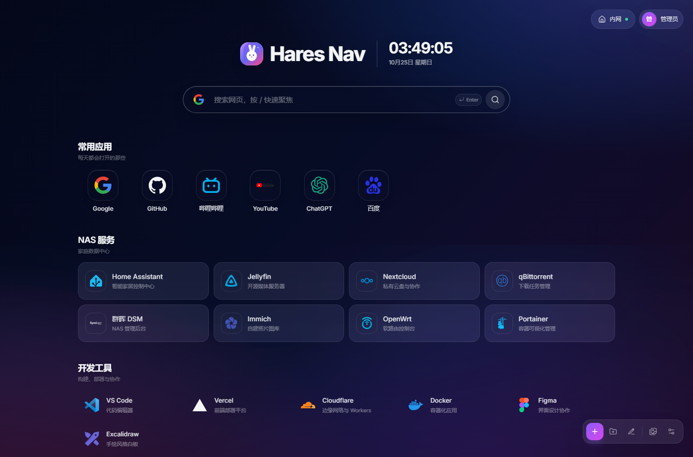
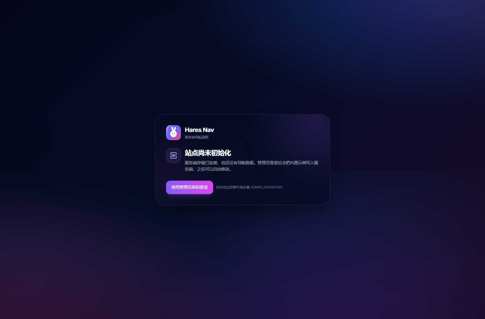
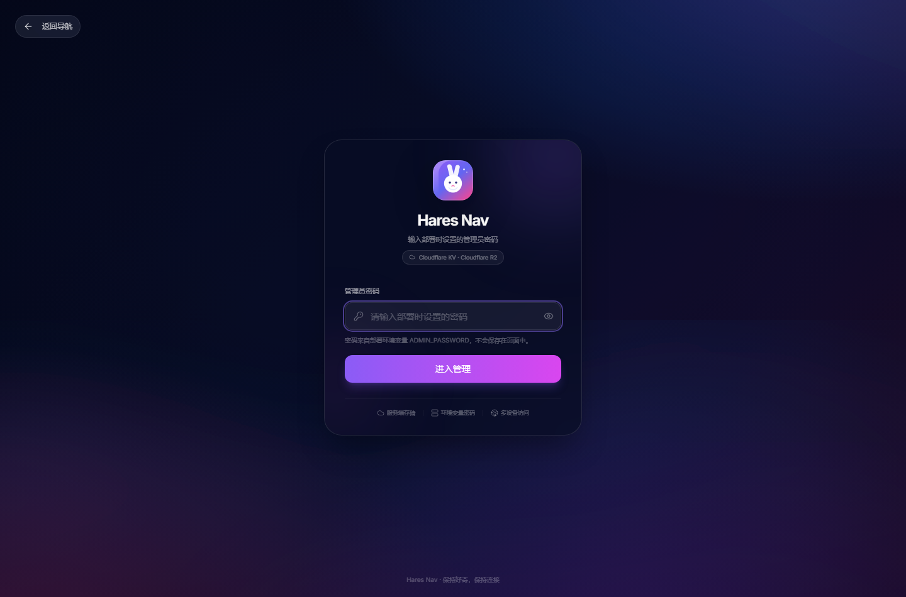
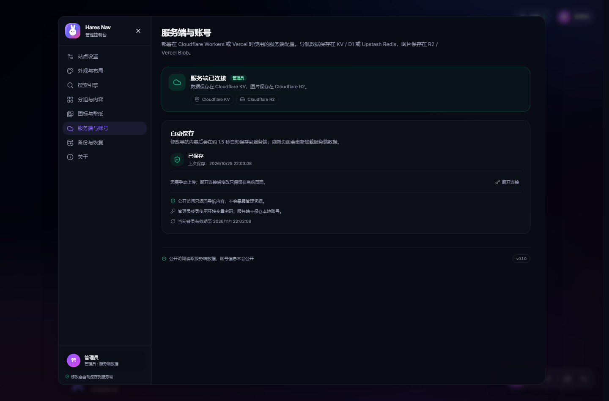

<div align=center>


# Hares-Panel

Hares-Panel 是一个面向 NAS、家庭服务器和云主机的导航首页。前端与 API 打包在同一个镜像中，只依赖一个持久化目录即可运行。 [[DEMO]](https://demo.hares.eu.cc)



</div>

## 功能

| 模块 | 说明 |
| --- | --- |
| 导航卡片 | 名称、描述、外网/内网地址、角标、图标与颜色、两种打开方式、访客隐藏 |
| 分组 | 增删改、上下移动、独立卡片样式、访客隐藏、默认收起/展开、空状态引导；卡片可跨分组拖拽 |
| 拖拽排序 | 基于 `@dnd-kit`，编辑模式拖动手柄，支持键盘操作与拖拽浮层 |
| 四种卡片样式 | `icon` 图标 / `card` 卡片 / `solid` 纯色 / `transparent` 透明悬浮，分组可覆盖 |
| 搜索 | 多搜索引擎、增删改与排序、默认引擎、占位符、新标签页开关；站内卡片快速直达 |
| 时钟与日期 | 12/24 小时制、秒数开关、日期显示、中文星期 |
| 壁纸与遮罩 | 6 套内置渐变壁纸、上传图片、网络图片、图库选择、模糊与遮罩、圆角与光效 |
| 内外网切换 | 自动识别 / 优先内网 / 优先外网；卡片可配置内网地址，右键强制指定 |
| 图标库 | 178 个离线内置图标、Iconify 在线搜索、图片 URL、上传、服务端图库、删除对象、图标颜色 |
| 自动图标 | 优先读取目标网站自身 favicon；失败时使用 [favicon-api](https://github.com/xinac721/favicon-api) |
| 服务端存储 | 导航数据保存到 Cloudflare KV / D1、Vercel Upstash Redis、EdgeOne Blob 或 Docker 本地文件；启动即从 API 读取 |
| 对象存储 | 图片与图标保存到 Cloudflare R2、Vercel Blob、EdgeOne Blob 或 Docker 本地 `assets/`，数据库只存 URL 与对象 key |
| 自托管 | Docker 一键部署，直连高位端口（默认 18000）；状态与图片持久化到 `./data` |
| 版本更新 | 「关于」页自动检查 Docker Hub 镜像与 GitHub 源码版本，发现新版本时显示提示和升级入口 |
| 管理员认证 | 密码来自环境变量 `ADMIN_PASSWORD`；HMAC 签名令牌，7 天滑动有效期（访问自动续期） |
| 个人资料 | 管理员可自定义头像与显示名称，支持图片 URL、本地上传或图库引用，显示在右上角账户菜单 |
| 备份恢复 | 导出/导入 JSON 快照，自动保存到服务端；支持自动识别 FlatNas / Sun-Panel 备份并导入分组与卡片；图库只保存图片地址 |
| 自定义 | 自定义 CSS、JS、页脚 HTML、Logo 上传或 URL |
| 系统状态 | 浏览器可读取的本机 CPU 核心数、设备内存、存储、网络、电池信息 |

## 技术栈

- **React 18 + TypeScript + Vite 5**
- **Tailwind CSS 3.4 + shadcn/ui（Radix UI）**
- **Zustand 5**（内存状态 + 登录令牌持久化）
- **React Router 7**（HashRouter）
- **@dnd-kit**、**sonner**、**zod**、**@iconify/react**
- **Cloudflare Workers**（KV / D1 / R2）、**Vercel Functions**（Upstash Redis REST + `@vercel/blob`）、**EdgeOne Makers Node Functions**（`@edgeone/pages-blob`）与 **Docker 自托管**（Node 24 + 本地文件），共享同一套 API 核心
- **Tauri 2**（工程保留；待接入可配置的服务端地址）

## 架构

```
浏览器 SPA ──/api/*──> Cloudflare Worker（KV/D1 + R2）
                        或 Vercel Function（Upstash + Blob）
                        或 EdgeOne Makers Node Function（Blob）
                        或 Docker 容器（Node 文件存储）
```

- **服务端是唯一数据源**：启动时先请求 `/api/health`，再读取公开状态；管理员登录后读取完整状态。
- **登录**：登录页只接受 `ADMIN_PASSWORD`，成功后服务端签发 HMAC 令牌；令牌与 7 天会话分别保存在 `localStorage` 的 `hares-panel-cloud` 与 `hares-panel-session`。7 天内再次打开面板会自动续期：服务端重新签发令牌，有效期从当天重新计算；连续 7 天未使用才需要重新输入密码。
- **保存**：浏览器编辑内容后约 1.5 秒防抖，整份 `AppData` 覆盖写入服务端；图片上传成功后再写入图库元数据。界面只显示保存状态，失败时可重试。
- **公开访问**：`GET /api/state` 返回导航内容，管理凭据与管理员个人资料永不返回；关闭「公开访问」时只返回登录页配置与空内容。
- **初始化**：新部署没有数据时显示初始化页，管理员登录后写入内置示例数据，随后可自由修改。

<p align="center">
  
  
  
</p>

```
src/
├── components/nav/          # 导航页、卡片、分组、搜索、设置、启动/初始化门禁
├── components/ui/           # shadcn/ui 基础组件
├── data/                    # 示例数据、内置壁纸、离线图标子集
├── hooks/                   # 时钟、媒体查询、云状态启动与自动保存
├── lib/                     # API 客户端、备份、网络、图标、图片压缩
├── store/                   # Zustand：app / cloud / session / ui / window
└── types/
server/                      # 与运行时无关的 API 核心 + Cloudflare / Vercel / EdgeOne / 文件存储适配
server/main.ts               # Docker / npm start 的 Node HTTP 入口（SPA + /api）
server/file.ts               # Docker 本地文件存储（状态、图片、会话密钥）
worker/index.ts              # Cloudflare Worker 入口
api/[...path].ts             # Vercel Functions 入口
cloud-functions/api/[[default]].js  # EdgeOne Makers Node Function（构建时生成）
edgeone.json                 # EdgeOne 构建、Node 版本与输出目录
Dockerfile                   # Node 24 多阶段镜像
docker/entrypoint.sh         # 首次密码与 Node 启动
docker-compose.yml           # 默认编排：只发布面板高位端口
tests/                       # API、Worker/Vercel/EdgeOne/Docker 运行时测试与本地模拟后端
src-tauri/                   # Tauri 2 桌面工程（待接入远程 API）
```

更详细的数据结构见下文「服务端数据」。

## 快速开始

要求 **Node.js 24（`24.x`）**，与 `package.json` 中的 `engines.node` 保持一致。

后端是必需的。开发时使用内存模拟服务端：

```bash
npm install

# 终端 1：模拟 API（内存存储 + 模拟 R2，端口 8787）
npm run dev:api

# 终端 2：Vite（/api 自动代理到 8787）
npm run dev
```

打开 `http://localhost:5173`：

1. 首次打开显示「站点尚未初始化」；
2. 点击「使用管理员密码登录」，输入模拟密码 **`cloud-pass-123`**；
3. 登录后自动把内置示例数据写入模拟服务端，然后进入导航页；
4. 之后的修改会自动保存到模拟服务端，刷新后仍在。

> 模拟服务只用于开发，数据保存在内存中，重启后清空。生产密码请使用环境变量 `ADMIN_PASSWORD`。

> 生产部署（Cloudflare Workers / Vercel / EdgeOne Makers）见下方「部署」章节；不能只部署 `dist/`。

### 常用脚本

| 命令 | 作用 |
| --- | --- |
| `npm run dev` | Vite 开发服务器（`/api` 代理到 8787） |
| `npm run dev:api` | 内存模拟 API，供开发与本地预览使用 |
| `npm run build` | 类型检查 + 生产构建（自动使用项目内临时目录，避免 Windows 的 TEMP 权限问题） |
| `npm run build:docker` | 构建 SPA 与自托管 Node 服务端（`dist/` + `server-dist/index.mjs`） |
| `npm run start` | 本地运行自托管服务（先执行 `npm run build:docker`，默认端口 18000） |
| `npm run preview` | 预览生产构建（需要 8787 的 API，或部署后的同源 API） |
| `npm run mock:api` | 模拟 API + 静态 `dist/`，端口 4180 |
| `npm run test:api` | API 核心、Worker、Vercel、EdgeOne、Docker 运行时与备份导入测试 |
| `npm run docker:build` | 构建 Docker 镜像 `hares-panel:latest` |
| `npm run docker:up` | `docker compose up -d --build` 一键启动 |
| `npm run deploy:cf` | 构建并部署到 Cloudflare Workers |
| `npm run deploy:vercel` | 构建并用 Vercel CLI 部署 |
| `npm run tauri:dev` | Tauri 桌面窗口（需 Rust；远程 API 支持待后续） |

## 部署

Hares-Panel 由 **静态前端 + 同源 `/api`** 组成，不能只托管 `dist/`。生产环境请选择下面四种方式之一：

| 平台 | 导航数据 | 图片 / 图标 | 适合场景 |
| --- | --- | --- | --- |
| **Cloudflare Workers** | D1（推荐）或 KV | R2 | 已有 Cloudflare 账号，想要低延迟和免费额度 |
| **Vercel** | Upstash Redis | Vercel Blob | 已在用 Vercel，希望从 Git 仓库自动部署 |
| **EdgeOne Makers（国际版）** | EdgeOne Blob | EdgeOne Blob | 使用腾讯国际站，希望 Node Functions + Blob 一体化 |
| **Docker 自托管** | 本地 `./data/state.json` | 本地 `./data/assets/` | 有 NAS / 云主机，想一条命令部署；公网可配合现有反代 |

> 各平台的数据完全独立，不会自动同步。切换平台前请阅读「数据迁移与备份」。

### 部署前准备

1. 安装 **Node.js 24（`24.x`）** 和 npm；
2. 在本地执行一次完整构建，确认没有类型或构建错误：

   ```bash
   npm install
   npm run build
   ```

3. 准备管理员密码 `ADMIN_PASSWORD`。它只放在部署平台的环境变量中；
4. 建议准备一个自定义域名。`*.workers.dev`、`*.edgeone.cool` 等平台默认域名在部分网络下可能被阻断或需要额外访问凭据；
5. 新部署没有数据时，首页会显示「站点尚未初始化」。管理员登录后会把**内置示例数据**写入服务端，之后在页面中编辑即可。

### 通用环境变量

| 变量 | 必需 | 说明 |
| --- | --- | --- |
| `ADMIN_PASSWORD` | 通常是（Docker 可留空） | 管理员登录密码；Docker 留空时首次启动自动生成并保存到 `./data/admin-password` |
| `SESSION_SECRET` | 否 | HMAC 令牌签名密钥；设置后修改密码不会让旧令牌自动失效，可单独轮换；Docker 留空时自动生成并保存到 `./data/session-secret` |

各平台的存储凭据（D1/R2 绑定、Upstash、Vercel Blob、EdgeOne Blob）在对应章节单独配置。

### Cloudflare Workers

部署结构：

```text
浏览器
  ├── 静态 SPA ──> Worker ASSETS（dist/）
  └── /api/*   ──> Worker ──> D1 或 KV（导航数据）
                         └──> R2（图片）
```

**推荐组合：D1 + R2。** D1 适合频繁保存，R2 用来存图片；KV 也可以，但存在最终一致和单 key 写入频率限制。

#### 1. 登录 Cloudflare

```bash
npx wrangler login
npx wrangler whoami
```

`whoami` 能显示账号信息后继续。

#### 2. 创建 D1 数据库（推荐）

```bash
npx wrangler d1 create hares-panel
```

命令会输出 `database_id`，下一步填进 `wrangler.jsonc`。

如果不想用 D1，可以跳过，改用文末的 KV 方案。

#### 3. 创建 R2 存储桶

```bash
npx wrangler r2 bucket create hares-panel-assets
```

R2 桶**不需要开启公共访问**：图片会通过 Worker 的 `/api/assets/:key` 读取。没有 R2 时导航文字仍可使用，但图片上传功能不可用。

#### 4. 配置 `wrangler.jsonc`

项目已经写好了 Worker 入口、`ASSETS` 静态资源绑定和示例绑定。**仓库里的 D1 ID / R2 名称只是当前示例，部署到你自己的 Cloudflare 账号前必须全部替换成你自己的资源**，避免误部署到别人的账号资源。

```jsonc
{
  "name": "hares-panel",
  "main": "worker/index.ts",
  "assets": {
    "directory": "./dist",
    "binding": "ASSETS",
    "not_found_handling": "single-page-application"
  },
  "d1_databases": [
    {
      "binding": "hares_panel",
      "database_name": "hares-panel",
      "database_id": "<你的 D1 database_id>"
    }
  ],
  "r2_buckets": [
    {
      "bucket_name": "hares-panel-assets",
      "binding": "hares_panel_assets"
    }
  ]
}
```

说明：

- 也可以不用 CLI 创建：在 Cloudflare Dashboard 的 **Storage & Databases** 中创建 D1 / R2，再到 Worker → Settings → Bindings 添加同名绑定；效果与写 `wrangler.jsonc` 相同；
- `binding` 名称不要随意改；
- D1 表 `hares_panel_state` 不需要手动建表，首次读写时会自动创建；
- 如果同时绑定 D1 和 KV，会优先使用 D1；
- 如果使用其他数据库名或桶名，只需同步修改这里的 `database_name` / `bucket_name`。

#### 5. 设置管理员密钥

如果 Worker 还不存在，先执行下一步部署一次，再回来设置；也可以在 Cloudflare Dashboard → Worker → Settings → Variables and Secrets 中添加。

```bash
npx wrangler secret put ADMIN_PASSWORD
npx wrangler secret put SESSION_SECRET   # 可选
```

`secret put` 会交互式读取值，不要把密码写在命令行参数里，也不要提交 `.dev.vars`。如果设置后 `/api/health` 的 `auth` 仍为 `false`，重新执行一次 `npx wrangler deploy`。

#### 6. 构建并部署

```bash
npm run deploy:cf
```

这个脚本会先执行 `npm run build`（含类型检查和 Vite 构建），再执行 `wrangler deploy`。也可以分开执行：

```bash
npm run build
npx wrangler deploy
```

部署成功后记录 Worker 地址，例如 `https://hares-panel.<你的子域>.workers.dev`。

#### 7. 初始化与验证

1. 打开 Worker 地址；
2. 如果显示「站点尚未初始化」，点击「使用管理员密码登录」；
3. 输入刚设置的 `ADMIN_PASSWORD`，登录后写入内置示例数据；
4. 访问 `/api/health`，正常结果应类似：

   ```json
   {
     "ok": true,
     "runtime": "cloudflare-workers",
     "storage": "d1",
     "assets": "r2",
     "auth": true
   }
   ```

如果 `storage` 为 `null`，检查 D1/KV 绑定；如果 `assets` 为 `null`，检查 R2 绑定；如果 `auth` 为 `false`，检查 `ADMIN_PASSWORD` secret 是否已生效。

#### 8. 自定义域名、日志与更新

- **自定义域名**：Cloudflare Dashboard → Workers & Pages → 你的 Worker → Settings → Domains & Routes → Add custom domain，按提示添加 DNS 记录。绑定后使用自定义域名访问，可避开部分网络对 `workers.dev` 的阻断。
- **日志**：另开终端执行 `npx wrangler tail`，可实时查看 Worker 请求和错误。
- **更新代码**：修改后重新执行 `npm run deploy:cf`。D1/R2 中的数据不会被覆盖。
- **回滚**：在 Cloudflare Dashboard 的 Worker 部署历史中选择旧版本回滚。

#### 9. 本地 Worker 调试

在项目根目录创建 `.dev.vars`（已加入 `.gitignore`）：

```dotenv
ADMIN_PASSWORD=local-password
SESSION_SECRET=local-secret
```

然后启动 Worker 本地开发：

```bash
npx wrangler dev
```

本地 D1/R2 绑定会使用 Wrangler 的本地模拟存储；生产数据不会受影响。

#### 10. 只用 KV 的替代方案（可选）

如果不使用 D1：

```bash
npx wrangler kv namespace create hares_panel_kv
```

把输出中的 `id` 填入 `wrangler.jsonc`：

```jsonc
"kv_namespaces": [
  { "binding": "hares_panel_kv", "id": "<KV_NAMESPACE_ID>" }
]
```

然后照常设置 secret、构建和部署。KV 的导航状态保存在 `hares-panel:state:default`，适合访问量不大、修改不频繁的站点；频繁保存建议 D1。


### Vercel（Upstash Redis + Vercel Blob）

部署结构：

```text
Vercel CDN ──> dist/ 静态前端
     └─ /api/* ──> api/[...path].ts（Node Function）
                       ├─> Upstash Redis（导航数据）
                       └─> Vercel Blob（图片）
```

#### 首次部署顺序（重要）

首次部署请按 **先创建存储，后部署** 的顺序：

1. 在 Vercel 创建 / 导入项目（导入 Git 仓库时可能会自动生成一次初始部署，可以先忽略）；
2. 在项目的 **Storage** 中创建并连接 **Upstash for Redis**；
3. 在项目的 **Storage** 中创建并连接 **Blob**；
4. 在 **Settings → Environment Variables** 设置 `ADMIN_PASSWORD`（可选 `SESSION_SECRET`），至少勾选 **Production**；
5. 再执行首次正式部署：Git 推送，或本地执行 `npm run deploy:vercel`；
6. 打开域名初始化，并访问 `/api/health` 验证 `storage` 为 `redis`、`assets` 为 `blob`。

以上存储和变量也可以全程用 CLI 完成（见下文「方式 C」），不需要先打开网页。关键不是“部署几次”，而是**存储和变量必须在正式部署之前配置好**。

> 核心规则：**环境变量只对之后创建的部署生效。** 如果你先部署、后连接 Redis / Blob，已有部署不会自动生效，必须在连接完成后重新部署（Redeploy）一次。
>
> 使用 CLI 时，可以先执行 `vercel link` 创建并关联项目（不会立即部署），再连接存储和设置变量（网页或方式 C 均可），最后执行 `npm run deploy:vercel`，这样第一次部署就是配置完整的。

#### 1. 导入项目

在 Vercel Dashboard 选择 **Add New → Project**，导入 Git 仓库。构建配置：

| 配置项 | 值 |
| --- | --- |
| Framework Preset | Vite |
| Root Directory | 仓库根目录 |
| Install Command | `node scripts/vercel-command.mjs npm install` |
| Build Command | `node scripts/vercel-command.mjs npm run build` |
| Output Directory | `dist` |

仓库里的 `vercel.json` 已经声明了上述安装 / 构建命令、Vite 构建和静态资源回退；Dashboard 中保持默认即可，实际执行以 `vercel.json` 为准。`api/[...path].ts` 会被 Vercel 自动识别为 API Function，不需要单独配置路由。

#### 2. 创建 Upstash Redis

在 Vercel 项目的 **Storage / Marketplace** 中添加 **Upstash Redis**，创建后连接到当前项目。

连接成功后应生成以下环境变量之一：

```text
KV_REST_API_URL
KV_REST_API_TOKEN
# 或
UPSTASH_REDIS_REST_URL
UPSTASH_REDIS_REST_TOKEN
```

代码优先读取 `KV_REST_API_*`，也兼容 `UPSTASH_REDIS_REST_*`。必须是 **REST URL + REST Token**，不能只填 Redis TCP 地址。

#### 3. 创建 Vercel Blob

在 **Storage** 中添加 **Blob**，连接到当前项目，确认已生成：

```text
BLOB_READ_WRITE_TOKEN
```

> 连接 Blob 会自动添加环境变量，但**只对之后创建的部署生效**。如果项目已经部署过，必须重新部署（Redeploy）一次；否则 `/api/health` 仍会显示 `"assets": null`。

代码上传时使用 `access: 'public'`，图片由 Vercel Blob CDN 提供，不经过 Function 回源。Blob 中的图片是公开可访问的，请勿上传敏感图片。

#### 4. 设置环境变量

在 Vercel 项目 → **Settings → Environment Variables** 添加：

```text
ADMIN_PASSWORD=你的管理员密码
SESSION_SECRET=可选的随机字符串
```

`ADMIN_PASSWORD` 必填；`SESSION_SECRET` 可选，但建议生产环境设置。至少勾选 **Production**，如果使用预览部署也勾选 Preview。

#### 5. 部署

**方式 A：Git 自动部署**

把代码推送到已连接的 Git 仓库，Vercel 会自动构建并部署。

**方式 B：CLI 部署**

```bash
npm i -g vercel
vercel login
vercel link
npm run deploy:vercel
```

`npm run deploy:vercel` 会先在本地执行 `npm run build` 做一次类型检查和打包预检，再执行 `vercel --prod`。真正用于生产部署的产物仍由 Vercel 在云端重新构建，本地构建结果不会直接上传。首次执行 `vercel link` 时按提示选择 / 创建项目，这一步不会立即部署；请先完成 Redis / Blob 连接和环境变量设置，再执行 `npm run deploy:vercel`。

**方式 C：纯 CLI 首次部署（存储也走 CLI）**

Vercel CLI 可以直接创建 / 连接 Blob，也支持安装 Upstash Redis，不需要先去网页端手动建库：

```bash
vercel login
vercel link

# 1. Blob：创建并连接 Blob store
vercel storage create hares-panel-blob --type blob --access public
vercel storage connect hares-panel-blob --add-rw-token --yes --environment production --environment preview

# 2. Upstash Redis：通过 Marketplace 安装并连接
vercel install upstash
# 按提示选择 Upstash for Redis；若要求登录/授权，会在浏览器完成
# 成功后自动写入 KV_REST_API_* 或 UPSTASH_REDIS_REST_* 环境变量

# 3. 设置管理员密码
vercel env add ADMIN_PASSWORD production

# 4. 存储和变量都就绪后，只部署一次
npm run deploy:vercel
```

说明：

- 先执行 `vercel storage status` 可以查看当前已创建的存储，**已存在就不要重复 `storage create`**，否则会创建新的 Blob store；
- `vercel install upstash` 可能打开浏览器做 Upstash 账号授权，这是第三方 OAuth，不是让你去 Vercel 网页手动建库；
- 不想使用 Vercel Marketplace 的 Upstash 时，可以直接在 Upstash 创建数据库，然后用 CLI 写入变量：

  ```bash
  vercel env add UPSTASH_REDIS_REST_URL production --value "https://..."
  vercel env add UPSTASH_REDIS_REST_TOKEN production --value "..."
  ```

- `vercel deploy` 本身不会创建 Redis / Blob，也不会读取本地 `.env`；它只部署代码，并绑定部署创建时项目里已有的变量。所以存储要在 `deploy` 之前配置，但**只需要部署一次**。

#### Vercel 实际执行顺序

无论是 Git 自动部署还是 `vercel --prod`，Vercel 都在云端按以下顺序执行：

1. **上传源码**：CLI / Git 把项目文件上传到 Vercel；
2. **Install**：执行 `vercel.json` 中的
   `node scripts/vercel-command.mjs npm install`。
   wrapper 先把 Vercel 注入的 `NPM_CONFIG_CACHE_DIR` 转换成 npm 认识的 `npm_config_cache`，再执行 `npm install`，避免 `Unknown env config "cache-dir"` 警告；
3. **Build**：执行 `vercel.json` 中的
   `node scripts/vercel-command.mjs npm run build`。
   依次运行 `tsc --noEmit`、`vite build`、`scripts/build-edgeone.mjs`，生成 `dist/` 和 `cloud-functions/api/[[default]].js`；
4. **Function 打包**：Vercel 的 Node Builder 处理 `api/[...path].ts`。`vercel.json` 中已为该函数设置 `"installCommand": ""`，跳过函数级重复安装（根目录依赖已在第 2 步安装完成），因此不会再次触发 npm 警告；
5. **部署产物**：`dist/` 静态文件进入 CDN，API 入口打包为 Node Function；环境变量在创建本次部署时绑定。

> 环境变量（包括连接 Upstash Redis / Blob 自动生成的变量）只对**之后创建的部署**生效。已经部署的 Function 不会自动读取新增变量，必须重新部署（Redeploy）。

#### 6. 初始化与验证

1. 打开 Vercel 分配的域名；
2. 显示「站点尚未初始化」时，点击「使用管理员密码登录」，输入 `ADMIN_PASSWORD`；
3. 登录成功后会把内置示例写入 Upstash Redis；
4. 访问 `/api/health`，正常结果应类似：

   ```json
   {
     "ok": true,
     "runtime": "vercel",
     "storage": "redis",
     "assets": "blob",
     "auth": true
   }
   ```

如果 `storage` 为 `null`，检查 Upstash REST 环境变量；如果 `assets` 为 `null`，检查 `BLOB_READ_WRITE_TOKEN`；如果 `auth` 为 `false`，检查 `ADMIN_PASSWORD` 是否已应用到当前环境。新增或修改环境变量后，需要对当前环境重新部署（Redeploy），已有部署不会自动读取新值。

#### 7. 自定义域名、日志与更新

- **自定义域名**：Vercel 项目 → Settings → Domains，添加域名并按提示配置 DNS；
- **日志**：Vercel 项目 → Deployments → 选择部署 → Functions / Logs；
- **更新代码**：Git 推送或再次执行 `npm run deploy:vercel`。Redis 和 Blob 中的数据不会被覆盖；
- **环境变量修改**：修改后需要重新部署（Redeploy）才会应用到运行中的 Function。

#### 8. 注意事项

- Vercel Function 请求体上限约 **4.5 MB**；前端会压缩普通图片，但超大原图 / GIF / SVG 可能失败。需要大图时请改用图片 URL 或 Cloudflare R2；
- 未配置 Upstash Redis 时，`/api/health` 返回 `ok: false`，页面显示「服务端尚未就绪」；
- Blob 只保存图片，导航状态仍在 Redis；两者需要同时配置；
- Vercel 的 Serverless Function 有执行时长限制，普通登录 / 保存 / 上传不受影响。

### EdgeOne Makers（腾讯国际版）

EdgeOne 使用 **Node Functions + EdgeOne Blob**，不需要单独创建 KV、数据库或 COS：

```text
静态 SPA ──> EdgeOne 静态资源（dist/）
/api/*   ──> cloud-functions/api/[[default]].js（Node Function）
                 ├─> state/default.json（导航数据）
                 └─> assets/（图片）
```

#### 1. 项目结构与构建

关键文件：

```text
.nvmrc                               # EdgeOne / nvm 构建 Node 版本（24.18.0）
edgeone.json                         # 构建、Node 版本、输出目录
server/edgeone.ts                    # EdgeOne Blob 适配层
server/edgeone-entry.ts              # Node Function 入口
cloud-functions/api/[[default]].js   # 由 npm run build 生成，需随仓库部署
```

`edgeone.json` 当前配置：

```json
{
  "installCommand": "npm ci",
  "buildCommand": "npm run build",
  "outputDirectory": "dist",
  "nodeVersion": "24.18.0",
  "cloudFunctions": {
    "maxDuration": 60
  }
}
```

> `nodeVersion` 只控制**构建环境**，不会改变 Node Function 运行时。EdgeOne 已预装 `24.18.0`；本仓库同时提供 `.nvmrc`（`24.18.0`），构建日志会打印 `[build] Node v...`，可确认实际版本。如果控制台项目设置仍是 22.x，请在「项目设置 → Node.js 版本」选择 `24.18.0` 后重新部署；旧部署不会自动切换。Node Function 运行时由平台固定（文档标注 v20.x，实际以 `/api/health` 的 `platform` 为准），与构建版本无关。

本地构建：

```bash
npm install
npm run build
```

构建结束时应看到：

```text
dist/
cloud-functions/api/[[default]].js
```

`cloud-functions` 入口由 [scripts/build-edgeone.mjs](scripts/build-edgeone.mjs) 从 `server/edgeone-entry.ts` 生成，不要手动修改生成文件。修改 `server/` 下代码后重新执行 `npm run build`，并提交更新后的 `cloud-functions/api/[[default]].js`。

#### 2. 导入 EdgeOne 项目

在 [EdgeOne Makers 国际版](https://pages.edgeone.ai) 导入 Git 仓库：

| 配置项 | 值 |
| --- | --- |
| Framework | Vite |
| Install Command | `npm ci` |
| Build Command | `npm run build` |
| Output Directory | `dist` |
| Node.js Version（项目设置） | `24.18.0` |
| Functions Directory（如果要求填写） | `cloud-functions` |
| 加速区域（Acceleration Area） | **全球可用区（不含中国大陆）** |

> 加速区域必须选择 **全球可用区（不含中国大陆）**：该区域绑定自定义域名**不需要工信部 ICP 备案**。「中国大陆可用区」和「全球可用区」（含中国大陆）都要求域名先完成 ICP 备案。
>
> 加速区域在项目创建时确定，之后无法修改（CLI 的 `-a` 也只对新建项目生效）。如果项目建错了区域，需要用新的项目重新创建。

> 不能只上传 `dist/`。EdgeOne 项目必须同时包含 `cloud-functions`，否则 `/api/*` 没有处理函数，页面会显示「服务端尚未就绪」。

#### 3. 设置环境变量

在 EdgeOne 项目 → **Environment Variables** 中配置 **Production** 环境：

```text
ADMIN_PASSWORD=你的管理员密码
SESSION_SECRET=可选的随机字符串
# 可选；默认命名空间就是 hares-panel
HARES_BLOB_STORE=hares-panel
```

`ADMIN_PASSWORD` 必填，否则登录接口会返回未配置错误。`HARES_BLOB_STORE` 不填时使用 `hares-panel`；同一个 EdgeOne 项目下有多个环境或部署需要隔离数据时，建议给每个环境设置不同的值。如果使用 Preview 环境部署，也请在 Preview 环境设置同样的变量。

不需要手动创建 Blob 命名空间：第一次成功访问 `/api/health` 或写入数据时会自动创建，之后可以在控制台 Blob 页面只读查看。

#### 4. 部署

**方式 A：Git 自动部署**

提交并推送仓库，EdgeOne 会执行 `npm ci`、`npm run build`，然后发布静态资源和 Node Function。

> 如果推送后控制台仍显示 Node 22.1，进入「项目设置 → Node.js 版本」改为 `24.18.0`，保存后**新建部署**。`edgeone.json` 和 `.nvmrc` 只影响新的构建，旧部署不会自动切换。构建日志应出现 `[build] Node v24.18.0`。

**方式 B：EdgeOne CLI**

```bash
npm i -g edgeone@latest
edgeone login --site global
edgeone makers deploy -n <项目名> -a overseas
```

`-a overseas` 对应 **全球可用区（不含中国大陆）**，绑定自定义域名无需 ICP 备案；默认的 `-a global` 是「全球可用区」（含中国大陆），自定义域名需要备案。`--site global` 只表示登录国际版控制台，与加速区域无关，保持不变。

> `-a` 只在**创建项目**时生效，加速区域创建后不能修改。如果已有项目是用 `-a global` 创建的，请换一个新项目名加 `-a overseas` 重新创建，并重新配置环境变量。

如果项目已经关联，可以省略 `-n`。CLI 会自动构建并部署；需要机器可读结果时加 `--json`。

> `edgeone makers deploy` 在**本机**执行 `npm ci` / `npm run build`，Node 版本取本机 `node -v`；`edgeone.json` / `.nvmrc` 主要影响 Git 云端构建。如果要求本机构建也使用 24.18.0，请先切换本地 Node 版本（如 `nvm use 24.18.0`）。云端构建版本在 EdgeOne 项目设置里选择。

> 如果 CLI 提示创建了新项目（例如原本项目不在 overseas 区域），记得在新项目的 **Environment Variables** 里补上 `ADMIN_PASSWORD`；否则部署成功后面板会因缺少管理员密码而无法登录。

Windows 本地部署注意：如果同时运行着 `npm run dev` / `npm run dev:api`，CLI 的 `npm ci` 可能因为 `node_modules/@esbuild/.../esbuild.exe` 被占用而失败。先停止开发服务器，或在一个干净目录中执行部署。

#### 5. 访问地址与自定义域名

EdgeOne 默认的 `*.edgeone.cool` 是**带访问控制的预览域名**：

- 直接打开裸域名通常返回 401；
- 需要在控制台项目概览点击 **Preview** 获取带 `eo_token` 的临时链接（约 3 小时有效）；
- 中国大陆网络直接访问预览域名可能返回 401；
- 页面内 `/api/*` 与页面同域，使用同一个访问链接 / Cookie 即可正常工作。

长期公开使用请绑定自定义域名：

1. 打开 EdgeOne 控制台 → 项目 → **Domains / 域名管理**；
2. 添加自定义域名；
3. 按控制台提示在 DNS 服务商添加 CNAME；
4. 等待证书签发后，用自定义域名访问，不再需要 `eo_token` 临时链接。

> 项目的加速区域为 **全球可用区（不含中国大陆）** 时，绑定自定义域名不需要 ICP 备案；如果选的是「中国大陆可用区」或「全球可用区」（含中国大陆），则必须先完成工信部 ICP 备案。

#### 6. 初始化与验证

1. 用控制台 Preview 生成的完整链接打开站点；
2. 显示「站点尚未初始化」时，点击「使用管理员密码登录」；
3. 输入 `ADMIN_PASSWORD`，登录后写入内置示例数据；
4. 访问 `/api/health`，正常结果应类似：

   ```json
   {
     "ok": true,
     "runtime": "edgeone",
     "platform": "v20.x · EdgeOne Makers",
     "storage": "edgeone-blob",
     "assets": "edgeone-blob",
     "auth": true
   }
   ```

> 这里的 `platform` 来自 Node Function 的 `process.version`，是**运行时版本**，不是构建环境版本；EdgeOne 文档标注为 v20.x，实际环境也可能显示 v22.x。构建环境版本请看构建日志里的 `[build] Node ...`。

   如果 `storage` / `assets` 为 `null`，依次检查：

- 部署产物中是否包含 `cloud-functions/api/[[default]].js`；
- 构建日志中是否出现 `Node functions build completed successfully`；
- 环境变量 `ADMIN_PASSWORD` 是否在 **Production** 环境；
- EdgeOne 控制台 → 日志分析中的 Function 错误，常见为 Blob 鉴权失败或命名空间不可用。

本地也可以单独验证适配层（不连接真实 Blob）：

```bash
node tests/edgeone.test.mjs
```

#### 7. EdgeOne 限制

- Node Function 请求体上限约 **6 MB**，本站单张图片限制为 **5 MB**；
- 免费版 Blob 容量 **1 GB**，导航状态与图片共用；
- Function 最长执行时间在 `edgeone.json` 中设为 60 秒；
- 图片通过 `/api/assets/:key` 由 Function 回源，不依赖 Blob 公网直链；
- Blob 读使用强一致模式，保存后刷新不会读到旧数据；
- 删除图片会同时删除 Blob 对象和导航数据中的引用。

参考：[EdgeOne Node Functions](https://pages.edgeone.ai/document/node-functions)、[EdgeOne Blob](https://pages.edgeone.ai/document/blob-storage)、[EdgeOne 错误码](https://pages.edgeone.ai/document/error-codes)。

### 部署后检查清单

无论使用哪个平台，部署完成后至少检查：

1. **健康检查**：访问 `/api/health`，确认 `ok`、`storage`、`assets`、`auth` 四个字段符合预期；
2. **首次初始化**：打开首页 → 登录 → 确认自动写入示例数据并能进入导航页；
3. **保存**：修改站点名称或添加一张卡片，等待自动保存后刷新页面，确认内容仍在；
4. **图片**：上传一张测试图片，确认能显示；删除后确认不再出现；
5. **公开访问**：退出管理员，确认访客能看到公开内容，且隐藏卡片 / 分组不出现在页面和 `/api/state` 中；
6. **备份**：在「管理控制台 → 备份与恢复」导出一份 JSON 快照。

### 数据迁移与备份

- 导航数据统一在「管理控制台 → 备份与恢复」导出 / 导入；
- 备份 JSON **不包含图片二进制**，只保存图片地址和对象 key；
- 切换平台时，除了导入 JSON，还需要把图片对象同步到新平台，或在导入后重新上传图片；
- Cloudflare R2、Vercel Blob、EdgeOne Blob 是独立存储，不会自动互相复制；
- Cloudflare D1/KV、Vercel Redis、EdgeOne Blob 之间也不会自动同步。切换平台后请以新平台的数据为准，不要同时编辑两套内容。

### 从其他面板导入

「管理控制台 → 备份与恢复 → 导入备份」会自动识别三种文件：

- **Hares-Panel 原生备份**：包含 `app: "hares-panel"` 的 JSON；
- **FlatNas 备份**：包含 `groups` / `items` / `widgets` / `appConfig` 的 JSON；
- **Sun-Panel 配置**：`appName` 为 `Sun-Panel-Config`，或包含 `icons` 分组数组的 `.sun-panel.json`。

#### 从 FlatNas 导入

FlatNas 导入规则：

- 分组标题、分组可见性、组内卡片会转换为本站分组与卡片；
- 卡片会尽量映射 `title`、`url`、`lanUrl`、`description1/2/3`、`openInNewTab`、`isPublic`、`icon`；
- FlatNas 导出文件同时包含 `groups[].items` 和顶层扁平 `items` 副本；导入会按卡片 `id` / 标题+地址去重，忽略重复副本，顶层多出的卡片放入「未分组卡片」；
- 卡片 `url` 为空时会回退使用 `backupUrls` / `alternateUrls`，`lanUrl` 为空时会回退使用 `backupLanUrls`；
- 站点名称与背景图会尝试从 `appConfig.customTitle` / `wallpaperConfig` 读取；
- 如果备份中没有导航卡片，会回退导入 bookmark 小组件的分类与链接；嵌套分类展开为 `父分类 / 子分类` 分组；
- 时钟、天气、待办、RSS 等其他小组件不会导入，导入结果中会列出提示；
- `/icon-cache/...`、`icons/...` 等 FlatNas 本地图标路径无法迁移（备份不包含图片本体），会留空并提示重新选择图标；`data:image/...` 内嵌图标和绝对 URL 会保留；
- 导入会替换当前服务端数据，操作前建议先导出一份本站备份。

仓库提供了一份可直接导入的测试文件：[examples/flatnas-backup-sample.json](examples/flatnas-backup-sample.json)。它包含 3 个分组、7 张组内卡片、1 张顶层未分组卡片、隐藏分组/隐藏卡片、`backupUrls` 回退、内嵌 SVG 图标和本地图标路径，可用于验证转换结果。

#### 从 Sun-Panel 导入

Sun-Panel 导入规则：

- 读取 `icons[]` 中的图标分组与组内卡片，按 `sort` 重新排序；
- 分组标题、分组描述、`hidden` / `isPublic` 会转换为本站分组属性；`cardStyle.style` 为 `0`（详情风格）时使用卡片样式，为 `1`（图标风格）时使用图标样式；
- 卡片会映射 `title`、`url`、`lanUrl`、`description`、`openMethod`；`openMethod` 1（当前页）转换为当前标签页，2（新窗口）转换为新标签页，3（站内浮层）转换为新标签页并在导入结果中提示；
- 图标支持 Sun-Panel 的三种类型：`itemType: 2` 图片 URL、`itemType: 3` Iconify 名称、`itemType: 1` 文字或 emoji；协议相对地址和 `data:image/...` 会保留；
- Sun-Panel 本地上传的图标（例如 `/upload/...`）无法迁移，因为备份不包含图片本体，会留空并提示重新选择图标；
- 如果文件包含 `styleConfig` / `panelConfig`，站点名称、Logo、背景图、时钟秒数、搜索框、内外网切换和系统状态开关也会尝试同步；
- Sun-Panel 的配置导出本身只包含图标分组，不包含待办、RSS 等其他模块数据；导入会替换当前服务端数据，操作前建议先导出一份本站备份。

仓库提供了一份可直接导入的测试文件：[examples/sun-panel-backup-sample.json](examples/sun-panel-backup-sample.json)，包含 3 个分组、6 张卡片、内外网地址、描述和图片图标，可用于验证转换结果。

### Docker 自托管（一键部署）

适合 NAS、家用服务器或云主机。镜像只运行 Node 服务，**不内置反向代理**：

> 需要从 Docker Hub 拉取镜像部署时，可参考 [Docker Hub 部署说明](docs/docker-hub/README.md) 和 [docker-compose.yml](docs/docker-hub/docker-compose.yml)。

- **Node 24 服务端**：提供 SPA 与 `/api/*`，状态和图片写入 `/data`；
- **面板直连端口**：宿主机 `18000` 与容器 `18000` 一致，不占用 80/443；
- **首次启动自动生成管理员密码**：未设置 `ADMIN_PASSWORD` 时写入 `/data/admin-password`，并打印到容器日志；
- **公网 HTTPS**：请使用 NAS 上已有的 Nginx / Caddy / 路由器反向代理到 `http://<NAS IP>:18000`。本项目不管理宿主机反代，也不处理证书。

#### 端口规划

| 用途 | 默认宿主机端口 | 容器端口 | 说明 |
| --- | --- | --- | --- |
| 面板 HTTP | `18000` | `18000` | 默认只发布这一个端口，宿主机与容器端口一致 |

`docker-compose.yml` 里写的是字面值 `"18000:18000"`，NAS 面板解析该文件时会直接预填这两个端口。要换宿主机端口：用 `deploy.sh` / `deploy.ps1` 的 `--port` / `-Port`（脚本会读取 `.env` 的 `PANEL_PORT` 并生成端口覆盖文件），或手动改 `docker-compose.yml` 的 `ports` 行。默认使用高位端口，避免和 NAS 上已有的应用 / 其他容器冲突。旧版本镜像的容器端口是 `3000`：升级镜像后把映射改成 `18000:18000`，或者给容器保留 `APP_PORT=3000`、`PORT=3000` 以继续使用 `18000:3000` 的映射。

#### 宿主机 `./data` 目录结构

```text
data/
├── state.json       # 导航数据（完整 JSON 文档）
├── assets/          # 上传的图片
├── session-secret   # 登录令牌签名密钥
└── admin-password   # 自动生成的管理员密码（仅在未设置 ADMIN_PASSWORD 时使用）
```

#### 方式 A：一键脚本（推荐）

Linux / macOS / NAS SSH：

```bash
chmod +x deploy.sh

# 默认 18000 端口
./deploy.sh
# 访问 http://<NAS IP>:18000

# 自定义高位端口
./deploy.sh --port 19000
```

Windows PowerShell（Docker Desktop）：

```powershell
.\deploy.ps1

.\deploy.ps1 -Port 19000
```

说明：

- 脚本会生成 `.env`（含随机管理员密码），执行 `docker compose -f docker-compose.yml up -d --build`，等待健康检查后输出访问地址和密码；
- 已有镜像、只想快速重启时加 `--no-build`（PowerShell 为 `-NoBuild`）；
- 如果 PowerShell 阻止脚本执行，可使用：

```powershell
powershell -ExecutionPolicy Bypass -File .\deploy.ps1
```

#### 方式 B：Docker Compose 手动部署

```bash
cp .env.example .env
# 编辑 .env；至少建议设置 ADMIN_PASSWORD，留空则容器首次启动自动生成
docker compose up -d --build
```

打开 `http://<服务器IP>:18000`。查看日志：

```bash
docker compose logs -f hares-panel
```

健康检查：

```bash
curl http://127.0.0.1:18000/api/health
```

正常结果应包含 `"runtime": "docker"`、`"storage": "file"`、`"assets": "file"`、`"auth": true`。

#### 方式 C：docker run

```bash
docker build -t hares-panel .
docker run -d --name hares-panel --restart unless-stopped \
  -p 18000:18000 \
  -e ADMIN_PASSWORD='换成强密码' \
  -v "$PWD/data:/data" \
  hares-panel
```

#### 方式 D：NAS 应用向导（飞牛 / 群晖）

飞牛（fnOS）、群晖（DSM）的 Docker 界面支持直接导入 `docker-compose.yml`。本仓库的 compose 里把端口写成了字面值 **`18000:18000`**（不是 `${PANEL_PORT:-18000}` 变量），所以导入或创建工作项目时，界面会直接预填成：

| 向导里的字段 | 值 | 说明 |
| --- | --- | --- |
| 本地端口（宿主机） | `18000` | 可改成其他空闲高位端口 |
| 容器端口 | `18000` | 容器内监听 18000，与宿主机一致 |
| 协议 | `TCP` | |
| 存储 / 卷 | `/data` → NAS 上的目录 | 例如 `/vol1/1000/docker/hares-panel/data` |

创建后访问 `http://<NAS IP>:18000`。

注意事项：

- 必须把 `/data` 挂到 NAS 上的持久目录：导航数据、上传图片、会话密钥、自动生成的密码都在这个目录，不挂载时重建容器会全部丢失。
- 如果界面用的是「选择镜像 → 创建容器」而不是 Compose：新镜像已经 `EXPOSE 18000` 且容器内监听 18000，界面同样会预填 `18000 → 18000`，直接创建即可（旧镜像 `EXPOSE 3000`，需要重新构建镜像）。
- 平台支持 Compose 时优先用上面的「方式 B」：`docker-compose.yml` 已经包含 `18000:18000`、`/data` 挂载、重启策略和日志轮转，不用逐项手填。

#### 方式 E：飞牛 fnOS 应用包（.fpk）

仓库里附带了飞牛应用中心的安装包 [hares-panel.fpk](fnos/hares-panel.fpk)（源码与打包脚本在 [fnos/](fnos/README.md)）。在「应用中心 → 手动安装」里选中它安装，完成后从桌面图标打开：

| 项 | 值 |
| --- | --- |
| 宿主机端口 | `18000`（来自 `manifest` 的 `service_port`） |
| 容器端口 | `18000`（compose 里 `${TRIM_SERVICE_PORT}:18000`） |
| 数据目录 | `${TRIM_PKGVAR}/data`，升级保留 |
| 访问地址 | `http://<NAS IP>:18000` |

> 应用包的价值是桌面入口、应用目录内的数据管理和升级管理；端口与镜像方式一致，都是 `18000:18000`。

重新打包需要 [fnpack](https://developer.fnnas.com/docs/cli/fnpack/)：在 `fnos/` 目录执行 `.\build.ps1 -Fnpack <fnpack.exe>`（Windows）或 `FNPACK=<fnpack> ./build.sh`（Linux/macOS），详见 [fnos/README.md](fnos/README.md)。

#### 环境变量

| 变量 | 默认值 | 说明 |
| --- | --- | --- |
| `ADMIN_PASSWORD` | 首次启动自动生成 | 管理员密码；留空时生成并保存到 `/data/admin-password` |
| `SESSION_SECRET` | 自动生成 | HMAC 令牌密钥；留空时保存到 `/data/session-secret` |
| `PANEL_PORT` | `18000` | 部署脚本使用的宿主机端口；手动跑 Compose 时请改 `docker-compose.yml` 的 `ports` 行 |
| `HARES_STATE_MAX_MB` | `16` | 导航数据大小上限（MB） |
| `HARES_ASSET_MAX_MB` | `16` | 单张图片大小上限（MB） |
| `TZ` | `Asia/Shanghai` | 容器时区 |
| `APK_MIRROR` | 空 | 构建时可选 Alpine 镜像源，例如 `https://mirrors.aliyun.com/alpine` |

#### 公网访问与 HTTPS

Docker 只提供 HTTP。需要公网访问或 HTTPS 时，用现有反向代理转发到面板端口，例如 Nginx：

```nginx
location / {
  proxy_pass http://127.0.0.1:18000;
  proxy_set_header Host $host;
  proxy_set_header X-Forwarded-Proto $scheme;
  proxy_set_header X-Forwarded-Host $host;
}
```

或 Caddy：

```caddyfile
panel.example.com {
  reverse_proxy 127.0.0.1:18000
}
```

证书、域名和 80/443 都由外部反向代理负责，不保存在 `./data`。不要把 `18000` 直接暴露到公网。

#### 数据备份、迁移与升级

- 定期备份整个 `./data` 目录（状态、图片、会话密钥、密码）；
- 只迁移内容时，可在「管理控制台 → 备份与恢复」导出 JSON，再在新部署导入；图片二进制不会进入 JSON，需要同步 `data/assets` 或在导入后重新上传；
- 升级代码后重新执行 `docker compose up -d --build`，`./data` 中的数据会保留；
- `./data` 包含密码和会话密钥；
- 文件存储按单容器设计，不要让多个容器副本同时写同一个 `./data` 目录。

#### 构建缓慢、拉取基础镜像失败或 apk 超时

Dockerfile 默认依次尝试 `mirrors.aliyun.com`、`mirrors.tuna.tsinghua.edu.cn` 和 Alpine 官方源（每个最多 60 秒），国内网络通常无需手动处理。也可以显式指定镜像源，在 `.env` 中设置：

```dotenv
APK_MIRROR=https://mirrors.aliyun.com/alpine
```

然后重新执行 `docker compose up -d --build`。Compose 会把该值作为构建参数传给 Dockerfile；设置后只使用该镜像源，不再自动回退。

如果构建在第一步 `FROM node:24-alpine` 就失败，报 `failed to authorize`、`failed to fetch oauth token`、`EOF` 或 `连接被重置`，说明本机访问 Docker Hub 被阻断（与代码无关）。换一个能访问的基础镜像即可：

```dotenv
# .env
NODE_IMAGE=docker.m.daocloud.io/library/node:24-alpine
```

```bash
docker compose up -d --build
# 或直接构建
docker build --build-arg NODE_IMAGE=docker.m.daocloud.io/library/node:24-alpine -t hares-panel .
```

`NODE_IMAGE` 是 Dockerfile 里 `FROM ${NODE_IMAGE}` 的构建参数，默认 `node:24-alpine`；其他可用的 Docker Hub 镜像源同理，填完整镜像地址（含仓库路径）即可。

### 其他静态托管

不再支持纯静态托管：应用需要同源 `/api` 才能运行。请使用 Workers、Vercel、EdgeOne Makers，或 Docker 自托管。

## 服务端数据

KV / D1 / Redis / EdgeOne Blob / Docker 本地文件中保存的是**一份完整 JSON 文档**，不是逐条记录：

```jsonc
// KV: hares-panel:state:default
// Upstash Redis: hares-panel:state:default
// EdgeOne Blob: state/default.json
// Docker: /data/state.json
{ "data": { "config": { ... }, "groups": [], "items": [], "searchEngines": [], "gallery": [] }, "updatedAt": 1792869195248 }

// D1: hares_panel_state(id='default', data TEXT, updated_at INTEGER)
```

- `config`：站点名/标题、Logo 引用、公开访问、主题与壁纸、卡片样式、搜索占位符、页脚 HTML、自定义 CSS/JS 等。
- `groups` / `items`：分组与卡片（地址、内外网、图标、角标、打开方式、隐藏、默认收起、排序）。
- `searchEngines`：搜索引擎与排序。
- `gallery`：图片 URL、对象 key、大小、创建时间；**不包含图片二进制**。

默认演示数据约 10 KB；Cloud 平台应用内上限 8 MB（Docker 默认 16 MB，可通过 `HARES_STATE_MAX_MB` 调整），但实际请求还受平台限制（Vercel 约 4.5 MB、EdgeOne 5 MB）。每次修改覆盖整份文档，`updatedAt` 由服务端生成。

图片上传后进入 R2 / Vercel Blob / EdgeOne Blob / Docker 本地 `data/assets/`：

```json
{
  "name": "logo",
  "category": "icon",
  "dataUrl": "/api/assets/asset-xxxx.webp",
  "remoteKey": "asset-xxxx.webp",
  "size": 5288
}
```

## API

| 方法 | 路径 | 鉴权 | 说明 |
| --- | --- | --- | --- |
| `GET` | `/api/health` | 否 | 存储类型、对象存储、密码是否已设置 |
| `GET` | `/api/update?current=0.1.1` | 否 | 对比 Docker Hub / GitHub 的最新版本，返回是否有更新（成功结果缓存约 12 小时） |
| `POST` | `/api/login` | 密码 | 校验 `ADMIN_PASSWORD`，返回 HMAC 令牌（按 IP 限流） |
| `POST` | `/api/session/refresh` | Bearer | 续期登录令牌，返回新的 7 天令牌与到期时间 |
| `GET` | `/api/state` | 否 | 公开投影（不含访客隐藏的卡片/分组）；关闭公开访问时返回配置与空内容（`locked`） |
| `GET` | `/api/state?full=1` | Bearer | 完整数据，仅管理员 |
| `PUT` | `/api/state` | Bearer | 覆盖保存，Cloud 平台默认上限 8 MB（Docker 默认 16 MB） |
| `POST` | `/api/assets` | Bearer | `multipart/form-data` 上传图片 |
| `GET` | `/api/assets/:key` | 否 | Worker / R2 / EdgeOne / Docker 回源图片；Vercel Blob 由 CDN 提供 |
| `DELETE` | `/api/assets/:key` | Bearer | 删除 R2 / Vercel Blob / EdgeOne Blob / Docker 本地对象 |

## 安全说明

- 管理员密码只存在于部署平台环境变量或 Docker 数据目录，服务端不会通过 API 返回，也不会写入导航数据。Docker 在未设置 `ADMIN_PASSWORD` 时会自动生成密码并保存到 `./data/admin-password`，请限制数据目录权限。
- 登录令牌由 HMAC-SHA256 签名；未设置 `SESSION_SECRET` 时由 `ADMIN_PASSWORD` 派生，修改密码会让旧令牌立即失效。Docker 会自动生成独立的 `./data/session-secret` 并持久化。
- 登录令牌采用滑动有效期：7 天内再次打开或使用面板时自动续期；连续 7 天未使用、退出登录或修改 `ADMIN_PASSWORD` 后需要重新登录。
- 公开接口不会返回管理凭据或访客隐藏的卡片/分组；关闭「公开访问」后匿名请求只能拿到登录页配置。
- 令牌保存在 `localStorage`，自定义 JS 若被注入恶意代码可能读取令牌；请只使用自己编写的脚本。
- 部署平台仍然可以读取你保存的导航数据与图片；请不要存放密码、密钥等敏感信息。
- Docker 只提供高位端口的 HTTP（无 TLS），登录密码和数据会以明文经过网络；公网访问请用现有 Nginx / Caddy 等反向代理做 HTTPS，或通过 VPN / 内网访问。
- 登录限流为单实例内存计数，Cloudflare / Vercel / EdgeOne / 多副本部署下只能减缓暴力尝试；建议同时启用平台级 WAF / 访问策略。Docker 文件存储按单容器设计，请不要运行多个副本共享同一数据目录。

## 已知限制

- **Tauri 远程连接尚未完成**：Tauri 工程保留，但当前需要可配置的 API 地址后才能使用；Docker 部署可作为它的远程后端。
- **不支持离线/纯静态运行**：这是移除本地模式后的有意取舍；API 不可用时只显示部署提示。
- **备份文件不含图片二进制**：迁移到新部署时需要同步 R2 / Blob / Docker `data/assets`，或重新上传图片；FlatNas 的 `/icon-cache/...`、Sun-Panel 的 `/upload/...` 等本地图标也无法迁移。
- **面板不管理 Docker 容器**：Docker 只负责运行本站；Workers / Vercel / EdgeOne 函数同样无法访问宿主机 Docker。
- **Docker 文件存储按单容器设计**：不要用多个副本同时挂载同一个 `./data`；需要多副本时应改用支持共享存储的外部数据库/对象存储方案。
- **Vercel 请求体上限约 4.5 MB**：前端会先压缩图片；超大原图请改用 Cloudflare R2 或 Docker 自托管。
- **EdgeOne 请求体上限约 6 MB**：单张图片上限 5 MB；免费版 Blob 容量 1 GB，状态与图片共用。
- **平台数据不互通**：Cloudflare、Vercel、EdgeOne、Docker 的状态和图片存储互相独立，切换平台不会自动迁移。
- **KV 写入限制**：同一 key 约 1 次/秒且最终一致，频繁编辑建议使用 D1。
- **依赖安全公告**：`npm audit` 会报告 Vite / Wrangler 等构建工具与 Vercel Blob SDK 的传递依赖公告；前端静态产物不受影响。

## 升级与版本检查

管理控制台「关于」页会读取 Docker Hub 镜像标签、GitHub 主分支的 `package.json`（以及 jsDelivr 镜像）来判断是否有新版本。只要有任一来源返回比当前构建更高的版本，侧边栏「关于」和版本号旁就会显示「有新版本」，并提供升级说明入口。

- 检查只读取公开版本信息，不会上传导航数据、图片或凭据；成功结果缓存约 12 小时，失败结果保留 10 分钟，避免离线环境反复请求。
- 「关于」页的「检查更新」会跳过缓存立即刷新。
- 版本提示按已发布的语义化版本号比较；同一版本号重新构建镜像（例如只更新基础镜像）不会单独提示。
- 检查需要服务端能访问 `hub.docker.com`、`raw.githubusercontent.com` 或 `cdn.jsdelivr.net`；内网隔离环境可在「关于」页手动重试。
- Docker 升级：`docker compose pull && docker compose up -d`（升级不会删除 `./data`）。
- 飞牛应用：在应用中心升级 `.fpk`；Cloudflare / Vercel / EdgeOne：拉取新代码后重新部署。

## 常见问题

**页面显示「服务端尚未就绪」？** 检查 `/api/health` 是否返回 JSON 且 `ok: true`；确认已配置 KV/D1、Upstash Redis、EdgeOne Blob 或 Docker 的 `./data` 目录，并在对应平台设置了 `ADMIN_PASSWORD`（Docker 可留空自动生成）。Docker 还需确认宿主机 `18000` 已映射到容器 `18000`。

**页面显示「站点尚未初始化」？** 服务端可用但没有数据。点击登录，输入 `ADMIN_PASSWORD`，登录后会把内置示例写入服务端。

**EdgeOne 显示「服务端尚未就绪」？** 先访问 `/api/health`：若 `storage`/`assets` 为 `null`，确认部署包含 `cloud-functions/api/[[default]].js`、`@edgeone/pages-blob` 已安装、`ADMIN_PASSWORD` 已配置；再查看 EdgeOne 函数日志中的 `EdgeOne Blob store is unavailable` 或鉴权错误。Blob 命名空间会在第一次成功访问后自动创建。

**EdgeOne 登录 / 保存返回 500？** 确认部署的是最新代码，并且 `cloud-functions/api/[[default]].js` 已重新生成；同时检查 EdgeOne 函数日志。Node Function 的请求体兼容处理、Blob 初始化错误都会记录在这里。

**EdgeOne 构建仍显示 Node 22.1？** `edgeone.json` 的 `nodeVersion` 和 `.nvmrc` 只影响新的构建。进入「项目设置 → Node.js 版本」选择 `24.18.0`，保存后新建部署；构建日志应出现 `[build] Node v24.18.0`。`/api/health` 里的 `platform` 是 Function 运行时版本，不是构建版本。如果下拉里没有 `24.18.0`，说明该区域控制台还没同步该镜像；`.nvmrc` 会尝试下载对应版本，仍失败时可先用 `22.21.1`（代码兼容），或联系 EdgeOne 支持。

**EdgeOne CLI 部署的 npm ci 报 ERESOLVE（vite 8 与 plugin-react 4 冲突）？** 本项目锁定 **Vite 5.4.21 + @vitejs/plugin-react 4.7.0**；不要单独把 Vite 升到 8。Vite 8 需要 plugin-react 5.2+，并且要求 Node `>=22.12`，与 EdgeOne 常见的 22.1 不匹配。恢复依赖：

```bash
npm install --save-dev vite@5.4.21 @vitejs/plugin-react@4.7.0
npm ci
```

**EdgeOne CLI 部署用的是本地 Node 还是云端 Node？** `edgeone makers deploy` 会在本机执行 `npm ci` / `npm run build`，使用**本地 Node 版本**；`edgeone.json` / `.nvmrc` 主要作用于 Git 云端构建。要看 CLI 实际版本，直接看部署日志或执行 `node -v`；云端构建版本看 EdgeOne 项目设置。

**修改没有保存？** 查看「管理控制台 → 服务端与账号」中的保存状态与上次保存时间；若令牌过期会提示重新登录。失败时点提示条上的「重试」。

**保存时提示无法连接服务端？** 前端会自动重试一次。若页面能打开但请求持续失败，通常是当前网络阻断了 `*.workers.dev` 或 EdgeOne 预览域名；请绑定自定义域名后访问，或改用 Vercel。也可以用手机热点验证是否为网络问题。EdgeOne 裸域名 401 属于预览域名访问控制，需要 Preview 链接。

**图片上传失败？** 需要配置 R2（Workers）、Vercel Blob 或 EdgeOne Blob，并确保当前登录状态有效。Vercel 还需注意约 4.5 MB 的请求体限制；EdgeOne 单张图片上限为 5 MB，超大 SVG / GIF 建议改用图片 URL 或 Cloudflare R2。

**自动取图标失败？** 会先尝试目标网站自己的 `/favicon.ico` / PNG / SVG，失败后使用 [xinac721/favicon-api](https://github.com/xinac721/favicon-api)接口；不再依赖 Google。如果目标站点没有图标、被防火墙拦截，或内网 HTTP 地址在 HTTPS 页面中无法直接读取，请手动选择图标、填写图标 URL 或上传图片。

**`npm run build` 在 Windows 上报 `esbuild ... Access is denied`？** 构建脚本 [scripts/build.mjs](scripts/build.mjs) 已把 `TEMP/TMP/TMPDIR` 指向项目内的 `.build-tmp`，正常使用 `npm run build` 即可。不要直接运行 `vite build`；如果仍然失败，请检查杀毒软件或项目目录写权限。

**`wrangler deploy` 报找不到 D1 / R2？** 需要先把 `wrangler.jsonc` 中的 `<D1_DATABASE_ID>` 换成真实 ID，并创建对应的 R2 bucket；详见「部署」章节。`wrangler deploy --dry-run` 不会校验资源 ID。

**容器日志里的自动生成密码登不上？** 自动密码是 32 位 base64url 字符串，服务端不会 trim，多一个空格、少一个字符都会返回 401。旧版入口脚本生成的密码可能以 `-` 开头，日志里那一行还带前导空格，复制时最容易漏掉 `-`。取准确值：

```bash
docker exec <容器名> cat /data/admin-password
```

也可以直接设置 `ADMIN_PASSWORD` 环境变量覆盖它（设置后以环境变量为准）。新版镜像生成的首尾字符一定是字母或数字，并且密码单独一行输出，不再带前导空格。

**忘记密码？** 修改部署平台的 `ADMIN_PASSWORD`：Cloudflare 使用 `wrangler secret put`，Vercel 在 Environment Variables 中修改，EdgeOne 在项目环境变量中修改；保存后重新部署 / 刷新即可，无需在页面中重置。Docker 可以修改 `.env` 后执行 `docker compose up -d`；如果是首次启动自动生成的密码，直接查看 `./data/admin-password` 或 `docker compose logs hares-panel`。彻底重置：删除 `/data/admin-password` 后重启容器，会重新生成并打印新密码。

**Docker 通过外部反代访问异常？** 确认反向代理目标指向 `http://<NAS IP>:18000`，并转发 `Host`、`X-Forwarded-Proto`、`X-Forwarded-Host`。HTTPS 证书由外部 Nginx / Caddy 负责，容器内不申请证书；可查看对应反向代理的日志排查。

**飞牛 / 群晖的 Docker 向导里端口显示多少？** 新版镜像 `EXPOSE 18000` 且容器内监听 18000，所以选镜像创建容器、或导入仓库里的 `docker-compose.yml`，都会显示 `18000:18000`。如果显示 `3000:3000`，说明用的还是旧镜像（旧版 `EXPOSE 3000`），重新构建镜像即可。

**FlatNas / Sun-Panel 导入后图标空白？** 这两个面板的备份只保存本地上传图标的路径（例如 FlatNas 的 `/icon-cache/...`、Sun-Panel 的 `/upload/...`），不包含图片本体，因此无法直接迁移；导入时这些图标会留空并给出提示，重新选择图标或填写图片 URL 即可。FlatNas 的嵌套 bookmark 分类会展开为 `父分类 / 子分类` 分组。

## 致谢

- [Sun-Panel](https://github.com/hslr-s/sun-panel)：交互与视觉参考
- [favicon-api](https://github.com/xinac721/favicon-api)：图标 API
- [shadcn/ui](https://ui.shadcn.com/) 与 [Radix UI](https://www.radix-ui.com/)
- [Iconify](https://iconify.design/) 及 `logos` / `simple-icons`
- [Tailwind CSS](https://tailwindcss.com/)、[Vite](https://vite.dev/)、[Cloudflare Workers](https://workers.cloudflare.com/)、[Vercel](https://vercel.com/)、[Tencent EdgeOne](https://pages.edgeone.ai/)、[Tauri](https://tauri.app/)

## 许可

[MIT](LICENSE)
